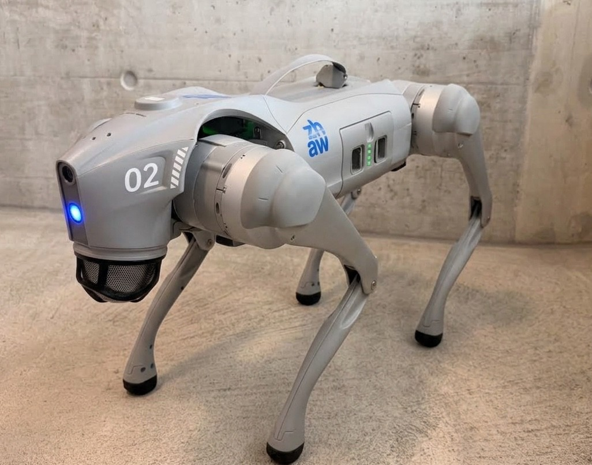

# KI trifft Robotik: Trainiere deinen Roboterhund

**Informationen für Organisatorinnen und Organisatoren** zur Planung, Vorbereitung und Ausschreibung des Workshops.

*Dieses Bild darf für die Ausschreibung verwendet werden. Bildnachweis: ZHAW*

---

## Ausschreibungstext

**Titel**

KI trifft Robotik: Trainiere deinen Roboterhund

**Beschreibung**

In diesem Workshop lernst du, wie ein KI-Modell trainiert und direkt auf einem Roboter eingesetzt werden kann.
Zuerst zeichnest du einen Pfeil auf ein Blatt Papier. Anschliessend trainierst du am Computer ein Modell, das den
Pfeil über eine Kamera erkennt und seine Richtung bestimmt. Danach überträgst du das Modell auf einen Roboterhund und
testest es in der Praxis. Drehst du den Pfeil, reagiert der Roboter darauf und bewegt sich in die entsprechende
Richtung. So erlebst du Schritt für Schritt, wie KI und Robotik zusammenspielen.

---

## Eckdaten

| | |
| :--- | :--- |
| **Teilnehmende** | maximal 20 Personen |
| **Dauer** | 1.5 bis 4 Stunden, der Inhalt wird an die verfügbare Zeit angepasst |
| **Arbeitsform** | Einzel oder in Zweiergruppen, 1 Laptop pro Gruppe |
| **Vorkenntnisse** | keine, Programmierkenntnisse sind nicht nötig |

---

## Was wir von Ihnen benötigen

### Raum

- [ ] **Raumreservation** für die gesamte Dauer, plus Zeit für Auf- und Abbau
- [ ] **Beamer** mit Anschluss für einen Laptop
- [ ] **Mobilfunknetz verfügbar** da wir über das Mobilfunknetz auf das Internet zugreifen, sollte der Raum vom Netz abgedeckt sein. 

### Laptops

- [ ] **Mind 1 Laptop pro 2 Teilnehmende**
- [ ] **Webcam** (eingebaut oder extern), damit die Pfeile fotografiert werden können
- [ ] **Aktueller Webbrowser**, z.B. Google Chrome

---

## Was wir mitbringen

- Roboterhund Unitree Go2
- Eigener WLAN-Router für die Verbindung zum Roboter
- Präsentation und Workshop-Unterlagen
- Papier oder Post-its und dicke Filzstifte zum Zeichnen der Pfeile stellen wir zur Verfügug.

---

## Ablauf

Die Inhalte werden je nach verfügbarer Zeit gekürzt oder vertieft.

1. **Begrüssung und Vorstellung:** Vorstellungsrunde und ein kurzes Bewegungsspiel («Links oder rechts?»)
2. **Was ist KI?** Beispiele aus dem Alltag, von Smartphones bis zu selbstfahrenden Autos
3. **Gefahren von KI:** Betrug, Deepfakes, Vorurteile (Bias) und Privatsphäre
4. **Programmieren oder Lernen?** Wann man Regeln programmiert und wann ein Modell aus Beispielen lernt
5. **Projekt mit dem Roboterhund**
   1. Daten sammeln: Pfeile zeichnen und mit der Webcam fotografieren
   2. Trainieren: ein eigenes KI-Modell im Browser trainieren
   3. Auf den Roboter: das Modell auf den Roboterhund übertragen
   4. Steuern: mit den Pfeilen den Roboter lenken
6. **Parcours im Simulator:** Wer gerade nicht am Roboter ist, steuert einen virtuellen Hund durch ein Labyrinth

---

## Kontakt

Bei Fragen zur Planung: *[Raphael De Gottardi, dego@zhaw.ch]*
